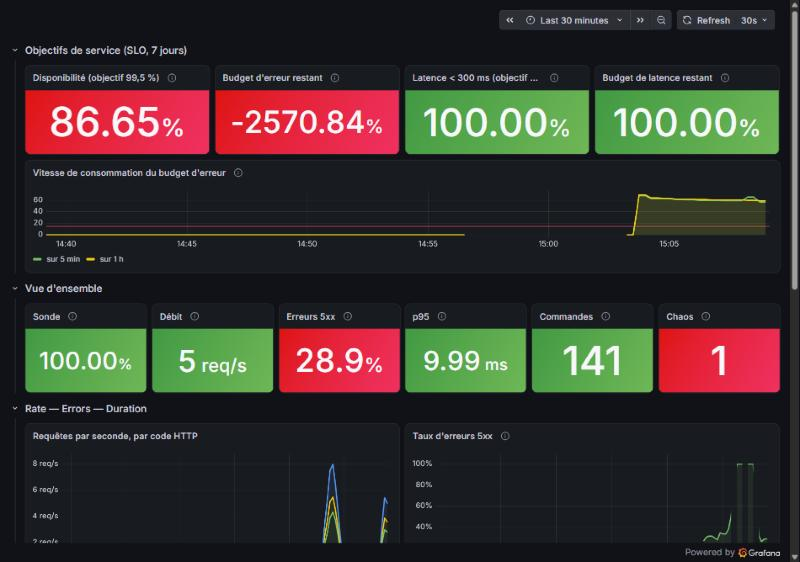
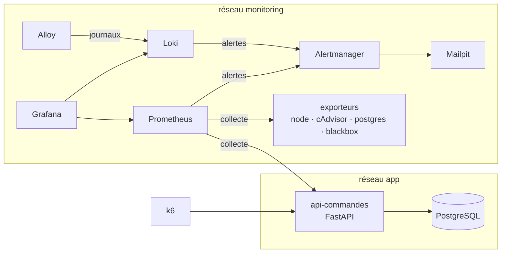

# observability-docker-lab


Chaîne de supervision complète en Docker Compose (métriques, journaux, tableaux de bord et alertes) autour d'une API de démonstration. Chaque alerte est prouvée en provoquant la panne correspondante.



## En bref

| | |
| --- | --- |
| **Métriques** | Prometheus 3.13 LTS, node-exporter, cAdvisor, postgres-exporter, blackbox-exporter |
| **Journaux** | Loki 3.7, Grafana Alloy (successeur de Promtail) |
| **Tableaux de bord** | Grafana 13, provisionnés en code (sources de données et JSON versionnés) |
| **Alertes** | 10 règles Prometheus + 1 règle sur journaux (Loki), Alertmanager (routage par gravité, regroupement, inhibition), Mailpit |
| **SLO** | Disponibilité 99,5 %, latence 95 % < 300 ms, budget d'erreur et alerte de consommation rapide (burn rate 14, fenêtres 5 min et 1 h) |
| **Charge et pannes** | Scénario k6, 6 pannes déclenchables par `make` |
| **Procédures** | Un runbook par alerte, lié depuis chaque notification |
| **CI** | 10 jobs GitHub Actions : lint, tests, promtool, amtool, Trivy, gitleaks, test de bout en bout de la pile complète |
| **Sécurité** | Ports sur 127.0.0.1, deux réseaux, conteneurs en lecture seule sans capacités, exceptions documentées |
| **Ressources** | Moins de 2 Go de RAM (limite par service), sur un portable de 8 Go |

## Architecture



Détail des services, des ports et des choix : [docs/01-architecture.md](docs/01-architecture.md).

## Résultats des pannes

Chaque panne a été provoquée sur la pile en fonctionnement ; le délai est mesuré entre le début de la panne et l'arrivée du mail dans Mailpit.

| Panne | Commande | Alerte | Destinataire | Mail reçu après | Résolution reçue après la fin |
| --- | --- | --- | --- | --- | --- |
| 30 % d'erreurs 500 | `make panne-erreurs` | ErreursApplicatives (Loki) | équipe | 2 min 33 | 5 min 13 |
| | | BudgetErreurRapide | astreinte | 3 min 21 | 6 min 01 |
| | | TauxErreursEleve | astreinte | 6 min 21 | 4 min 01 |
| 800 ms de latence | `make panne-latence` | LatenceElevee | équipe | 5 min 56 | 4 min 01 |
| API arrêtée | `make panne-api` | ApiIndisponible | astreinte | 1 min 44 | 2 min 54 |
| | | CibleInjoignable | équipe | 2 min 39 | 3 min 49 |
| Base arrêtée | `make panne-db` | ApiIndisponible | astreinte | 1 min 39 | 3 min 39 |
| | | PostgresIndisponible | astreinte | 1 min 49 | 3 min 49 |
| Mémoire vers 87 % de la limite | `make panne-memoire` | MemoireConteneurProcheLimite | équipe | 6 min 48 | |
| 3 arrêts par manque de mémoire | `make panne-redemarrages` | ConteneurRedemarre | équipe | 2 min 30 | après 15 min (fenêtre de la règle) |

Méthode, chronologie et analyse : [docs/10-resultats.md](docs/10-resultats.md).

## Démarrage rapide

Prérequis : Docker Engine et Docker Compose (Linux ou WSL2), `make`, environ 2 Go de RAM libre.

```bash
git clone https://github.com/Eliel-Emmanuel/observability-docker-lab.git
cd observability-docker-lab
make env          # crée .env : changer les mots de passe
make up           # construit l'API et démarre la pile
make ps           # tous les services « healthy »
```

| Interface | Adresse |
| --- | --- |
| Grafana | http://localhost:3000 (compte défini dans `.env`) |
| API | http://localhost:8000 |
| Mailpit (alertes reçues) | http://localhost:8025 |

`make up-debug` publie en plus Prometheus (9090), Alertmanager (9093), Loki (3100) et Alloy (12345), toujours sur `127.0.0.1`.

## Provoquer une panne

```bash
make panne-erreurs      # 30 % d'erreurs 500 sous charge
make panne-latence      # 800 ms de latence sous charge
make panne-api          # arrêt de l'API
make panne-db           # arrêt de PostgreSQL
make panne-memoire      # mémoire de l'API proche de sa limite
make panne-redemarrages # trois arrêts de l'API par manque de mémoire
make retablir           # fin de toutes les pannes
```

Puis observer : le tableau de bord **Service — api-commandes (RED)** dans Grafana, et les mails dans Mailpit. `make help` liste toutes les commandes.

## Documentation

| Page | Contenu |
| --- | --- |
| [Cahier des charges](docs/00-cahier-des-charges.md) | Exigences, critères d'acceptation, risques |
| [01 — Architecture](docs/01-architecture.md) | Services, réseaux, ports, décisions |
| [02 — Application](docs/02-application.md) | API de démonstration, base, points d'injection de pannes |
| [03 — Métriques](docs/03-metriques.md) | Prometheus et exporteurs |
| [04 — Journaux](docs/04-journaux.md) | Loki et Alloy |
| [05 — Tableaux de bord](docs/05-tableaux-de-bord.md) | Grafana provisionné |
| [06 — SLO](docs/06-slo.md) | Indicateurs, objectifs, budget d'erreur |
| [07 — Alertes](docs/07-alertes.md) | Règles, Alertmanager, inhibition, tests |
| [08 — Charge et pannes](docs/08-charge-et-pannes.md) | k6, pannes, runbooks |
| [09 — CI et sécurité](docs/09-ci-et-securite.md) | Pipeline, chaîne d'approvisionnement |
| [10 — Résultats](docs/10-resultats.md) | Mesures, captures, écarts |
| [Sécurité](docs/securite.md) | Mesures et exceptions |
| [Runbooks](docs/runbooks/README.md) | Une procédure par alerte |
| [Application](app/README.md) | Routes, variables, métriques |

## Licence

MIT
