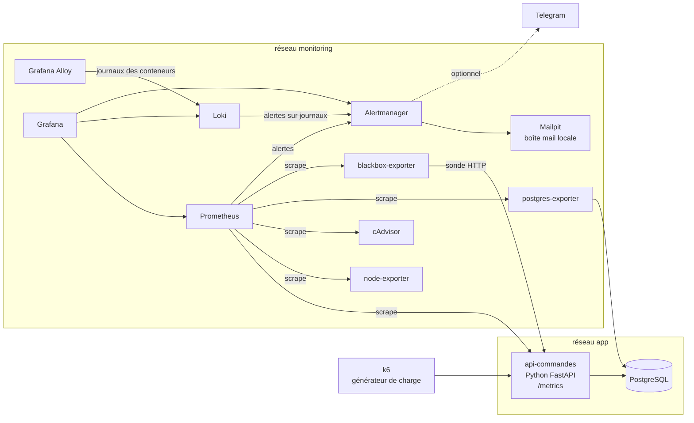

# Cahier des charges — observability-docker-lab

| Version | Date | Auteur | Statut |
| --- | --- | --- | --- |
| 1.2 | 23 novembre 2026 | @IT-SERVICES | Réalisé : état final du labo |

> Labo personnel de démonstration. L'application supervisée et ses données sont fictives. Les exigences sont identifiées (EF, ES, ENF) et chacune est reliée à une étape (section 5.2) et à un test (section 5.3).

## Sommaire

1. [Contexte et objectifs](#1-contexte-et-objectifs)
2. [Architecture cible](#2-architecture-cible)
3. [Exigences fonctionnelles](#3-exigences-fonctionnelles)
4. [Exigences de sécurité et non fonctionnelles](#4-exigences-de-sécurité-et-non-fonctionnelles)
5. [Livrables, étapes et critères d'acceptation](#5-livrables-étapes-et-critères-dacceptation)
6. [Contraintes, limites et risques](#6-contraintes-limites-et-risques)
7. [Journal des modifications](#7-journal-des-modifications)

## 1. Contexte et objectifs

Une petite équipe exploite une API de prise de commandes. Aujourd'hui, elle apprend les pannes par les clients. Ce labo met en place une chaîne de supervision complète, entièrement en conteneurs : métriques, journaux, tableaux de bord et alertes, pour détecter un incident avant les utilisateurs et en trouver la cause rapidement.

L'ensemble démarre avec une seule commande et tient dans moins de 2 Go de RAM.

**L'application supervisée est fournie** dans `app/`, avec ses tests et son Dockerfile. Elle sert de support : le projet porte sur son exploitation (conteneurisation, supervision, alertes, procédures, CI), pas sur son développement.

**Objectifs du projet**

1. Collecter les métriques de l'application, des conteneurs et de l'hôte (Prometheus).
2. Centraliser les journaux de tous les conteneurs (Loki, collectés par Grafana Alloy).
3. Visualiser l'état du service dans des tableaux de bord versionnés (Grafana).
4. Alerter sur des symptômes qui touchent les utilisateurs (erreurs, latence, indisponibilité), avec une procédure de résolution pour chaque alerte (Alertmanager).
5. Prouver chaque alerte en provoquant volontairement la panne correspondante.
6. Tout décrire en code, tester en intégration continue, et documenter pour qu'un autre ingénieur reconstruise le labo en quelques minutes.

**Compétences démontrées :** Docker et Docker Compose, Prometheus et PromQL, Loki et LogQL, Grafana (provisionnement, tableaux de bord as code), Alertmanager (routage, regroupement, silences), méthodes RED et USE, indicateurs de service (SLI) et objectifs (SLO), procédures d'astreinte (runbooks), lecture des métriques d'une application instrumentée, tests de règles d'alerte, intégration continue GitHub Actions, durcissement de conteneurs.

**Dans le périmètre :** l'application de démonstration, sa base de données, la collecte des métriques et des journaux, les tableaux de bord, les alertes et leurs notifications, les tests de charge et d'injection de pannes, la CI.

**Hors périmètre :** traces distribuées (Tempo), haute disponibilité de la supervision (Thanos, Mimir), déploiement sur Kubernetes ou dans le cloud. Ils pourront faire l'objet d'extensions (section 6.3).

## 2. Architecture cible

Tous les services tournent dans Docker Compose, sur deux réseaux : `app` (l'application et sa base) et `monitoring` (la chaîne de supervision). Seuls Grafana, l'application et Mailpit sont accessibles depuis l'hôte, et uniquement sur `127.0.0.1`. Un mode débogage (`compose.debug.yaml`) publie en plus Prometheus, Alertmanager, Loki et Alloy, toujours sur `127.0.0.1`.



### 2.1 Prérequis de l'hôte

**Poste hôte du labo : HP EliteBook, processeur Intel Core i5, 8 Go de RAM, Windows 11.**

- Ubuntu dans WSL2, avec **Docker Engine et le plugin Docker Compose installés directement dans Ubuntu** (dépôt officiel Docker), sans Docker Desktop. Docker Desktop isole son moteur dans une VM à part : cAdvisor n'y voit ni containerd ni les cgroups des conteneurs, et node-exporter ne peut pas lire `/proc`. Avec Docker Engine natif, WSL2 se comporte comme un serveur Linux et la RAM de la VM Docker Desktop est économisée.
- Mémoire de WSL2 limitée dans `%UserProfile%\.wslconfig`, pour laisser de la marge à Windows :

```ini
[wsl2]
memory=3GB
processors=2
swap=2GB
```

- Le dépôt est cloné **dans le système de fichiers d'Ubuntu** (`~/observability-docker-lab`), pas dans `C:\`. Les montages de fichiers de configuration y sont plus rapides et fiables, et `make`, `bash` et `git` y sont disponibles (`sudo apt install make git`).
- Fichier `.gitattributes` avec `* text=auto eol=lf` : les fichiers de configuration et les scripts gardent des fins de ligne Linux, même s'ils sont ouverts sous Windows.
- 5 Go de disque libre.
- WSL2 utilise la plateforme de virtualisation de Windows : VirtualBox fonctionne alors en mode ralenti. Ne pas faire tourner ce labo en même temps que des VM VirtualBox.
- Pendant les séances : navigateur limité à quelques onglets, applications lancées au démarrage désactivées.

### 2.2 Services

| Service | Image | Rôle | Port exposé | Limite RAM |
| --- | --- | --- | --- | --- |
| api-commandes | construite depuis `app/` | API de démonstration, instrumentée | 127.0.0.1:8000 | 128 Mo, sans swap |
| postgres | `postgres` 17 | Base de l'API | aucun | 192 Mo |
| prometheus | `prom/prometheus` 3.13 (LTS) | Collecte et stockage des métriques, évaluation des règles | aucun | 384 Mo |
| alertmanager | `prom/alertmanager` v0.35 | Regroupement, routage et envoi des alertes | aucun | 64 Mo |
| loki | `grafana/loki` 3.7, mode monolithique | Stockage des journaux, règles d'alerte sur journaux | aucun | 256 Mo |
| alloy | `grafana/alloy` v1.22 | Lecture des journaux Docker et envoi à Loki | aucun | 192 Mo |
| grafana | `grafana/grafana` 13.3 | Tableaux de bord, exploration | 127.0.0.1:3000 | 384 Mo |
| node-exporter | `prom/node-exporter` | Métriques de l'hôte (ici la VM WSL2 qui fait tourner Docker) | aucun | 32 Mo |
| cadvisor | `ghcr.io/google/cadvisor` v0.60 | Métriques par conteneur | aucun | 128 Mo |
| postgres-exporter | `prometheuscommunity/postgres-exporter` | Métriques de PostgreSQL | aucun | 32 Mo |
| blackbox-exporter | `prom/blackbox-exporter` | Sonde HTTP externe de l'API | aucun | 32 Mo |
| mailpit | `axllent/mailpit` | Boîte mail locale qui reçoit les notifications | 127.0.0.1:8025 | 64 Mo |
| k6 | `grafana/k6` | Générateur de charge, lancé à la demande (profil `charge`) | aucun | 128 Mo |
| **Total** | | | | **environ 2 Go au maximum** (limites cumulées), environ 1,1 Go en usage réel |

Toutes les versions sont épinglées dans `.env` (jamais le tag `latest`). Promtail n'est pas utilisé : il est en fin de vie depuis le 2 mars 2026, et Grafana Alloy le remplace.

### 2.3 Choix techniques

| Choix | Raison |
| --- | --- |
| Docker Compose plutôt que Kubernetes | Un seul fichier, démarrage en une commande, moins de 2 Go de RAM. Le passage sur Kubernetes est une extension (section 6.3). |
| Prometheus en version LTS | Correctifs de sécurité assurés sur toute la durée du projet, sans suivre le rythme des versions mineures toutes les 6 semaines. |
| Grafana Alloy pour les journaux | Successeur officiel de Promtail. |
| Mailpit pour les notifications | Aucun compte externe ni mot de passe réel nécessaire ; les mails d'alerte sont lisibles dans une page web locale. Telegram reste une option. |
| Application écrite pour le labo | Elle expose des points d'injection de pannes, ce qui permet de déclencher chaque alerte à la demande. |

## 3. Exigences fonctionnelles

### 3.1 Application de démonstration (fournie)

Ces exigences décrivent l'application fournie dans `app/` ; elles servent de contrat entre l'application et la supervision. Le travail du projet consiste à la construire, la déployer et la superviser.


- **EF-01** — Écrire `api-commandes`, une API Python (FastAPI) qui stocke des commandes dans PostgreSQL : `GET /commandes`, `POST /commandes`, `GET /sante` (vérification de la base comprise).
- **EF-02** — Instrumenter l'API avec `prometheus_client` selon la méthode RED : nombre de requêtes et d'erreurs par route et par code HTTP (`http_requests_total`), durée des requêtes en histogramme (`http_request_duration_seconds`), plus une métrique métier (`commandes_creees_total`). Métriques exposées sur `/metrics`.
- **EF-03** — Écrire les journaux en JSON sur la sortie standard : horodatage, niveau, route, code HTTP, durée, identifiant de requête.
- **EF-04** — Exposer des points d'injection de pannes, actifs uniquement si `CHAOS_ENABLED=true` : `POST /chaos/erreurs?taux=0.3` (part de réponses 500), `POST /chaos/latence?ms=800` (latence ajoutée), `POST /chaos/memoire?mo_par_seconde=2&max_mo=68` (fuite mémoire, plafonnée ou non), `POST /chaos/reset`.
- **EF-05** — Construire l'image avec un Dockerfile multi-étapes, utilisateur non root, image finale de moins de 200 Mo, vérification de santé (`HEALTHCHECK`).

### 3.2 Métriques

- **EF-06** — Prometheus collecte toutes les 15 s : l'API, node-exporter, cAdvisor, postgres-exporter, blackbox-exporter, Prometheus lui-même, Alertmanager, Loki et Grafana.
- **EF-07** — Chaque cible porte les étiquettes `service` et `env="lab"`, utilisées pour relier métriques et journaux dans Grafana.
- **EF-08** — Règles d'enregistrement (recording rules) pour les indicateurs coûteux : taux de requêtes, taux d'erreurs et latence au 95ᵉ centile par service, sur 5 minutes.
- **EF-09** — Rétention des métriques : 7 jours ou 2 Go au maximum (`--storage.tsdb.retention.time`, `--storage.tsdb.retention.size`).

### 3.3 Journaux

- **EF-10** — Alloy découvre les conteneurs par le socket Docker et envoie leurs journaux à Loki, avec les étiquettes `service`, `container` et `env`.
- **EF-11** — Alloy analyse les journaux JSON de l'API et transforme `niveau` en étiquette ; les autres champs restent dans le contenu (pas d'étiquette à forte cardinalité, comme l'identifiant de requête).
- **EF-12** — Rétention des journaux : 7 jours, appliquée par le compacteur de Loki.

### 3.4 Tableaux de bord

- **EF-13** — Grafana est provisionné par fichiers : sources de données (Prometheus, Loki, Alertmanager) et tableaux de bord dans `grafana/`. Aucun réglage n'est fait à la main dans l'interface.
- **EF-14** — Tableaux de bord rangés dans un dossier `Labo`. Réalisés : « Service — api-commandes (RED) », avec les journaux d'erreur intégrés, et « Conteneurs (USE) ». « Hôte » et « Journaux » restent à faire (section 6.3) ; l'exploration des journaux se fait dans Grafana Explore :

| Tableau de bord | Contenu |
| --- | --- |
| Service — api-commandes (RED) | Requêtes par seconde, taux d'erreurs, latence p50/p95/p99, commandes créées, disponibilité mesurée par la sonde, budget d'erreur restant (EF-16) |
| Conteneurs (USE) | CPU, mémoire par rapport à la limite, redémarrages, réseau, par conteneur |
| Hôte (USE) | CPU, mémoire, disque, charge |
| Journaux | Volume par niveau et par service, derniers journaux d'erreur, recherche libre |

- **EF-15** — Corrélation : les journaux d'erreur de l'API sont affichés sur le tableau de bord du service, sur la même période que les graphiques.

### 3.5 Indicateurs et objectifs de service

- **EF-16** — Définir et documenter deux SLO pour `api-commandes`, calculés sur 30 jours glissants (sur 7 jours dans le labo) :
  - disponibilité : 99,5 % des requêtes sans erreur 5xx ;
  - latence : 95 % des requêtes servies en moins de 300 ms.
  Le tableau de bord du service affiche le budget d'erreur consommé.

### 3.6 Alertes

- **EF-17** — Règles d'alerte Prometheus, chacune avec une gravité (`critical` ou `warning`), un résumé, une description et un lien `runbook_url` :

| Alerte | Condition | Durée | Gravité |
| --- | --- | --- | --- |
| ApiIndisponible | Sonde blackbox en échec | 1 min | critical |
| CibleInjoignable | `up == 0` pour une cible | 2 min | warning |
| TauxErreursEleve | Plus de 5 % de réponses 5xx | 5 min | critical |
| LatenceElevee | p95 supérieur à 500 ms | 5 min | warning |
| BudgetErreurRapide | Consommation du budget d'erreur 14 fois plus rapide que prévu (fenêtres 5 min et 1 h) | 2 min | critical |
| ConteneurRedemarre | Plus de 2 redémarrages en 15 min | immédiate | warning |
| MemoireConteneurProcheLimite | Plus de 85 % de la limite RAM | 5 min | warning |
| DisqueHotePresquePlein | Moins de 15 % d'espace libre | 10 min | warning |
| PostgresIndisponible | `pg_up == 0` | 1 min | critical |
| Watchdog | Toujours active | — | none |

- **EF-18** — Règle d'alerte sur les journaux, évaluée par le ruler de Loki : `ErreursApplicatives`, plus de 20 journaux de niveau `ERROR` en 5 minutes pour un même service.
- **EF-19** — Alertmanager regroupe par `alertname` et `service`, attend 30 s avant le premier envoi, renvoie toutes les 4 h tant que l'alerte dure, et envoie un message de résolution.
- **EF-20** — Routage : `critical` vers `astreinte@labo.local`, `warning` vers `equipe@labo.local`, tous deux dans Mailpit. `Watchdog` est routée vers un récepteur dédié (`watchdog@labo.local`) qui prouve que la chaîne d'alerte fonctionne. Telegram reste une option non configurée (section 6.3).
- **EF-21** — Règle d'inhibition : si `ApiIndisponible` est active, `TauxErreursEleve`, `LatenceElevee` et `BudgetErreurRapide` ne sont pas envoyées pour le même service.
- **EF-22** — Chaque alerte a une page de procédure dans `docs/runbooks/` : signification, impact, premiers diagnostics (requêtes PromQL et LogQL prêtes à copier), résolution, prévention.
- **EF-25** — Tests unitaires des règles d'alerte (`prometheus/tests/*.yml`) : pour chaque alerte, une série de données simulée qui doit la déclencher et une qui ne doit pas la déclencher.

### 3.7 Charge et injection de pannes

- **EF-23** — Un scénario k6 (`charge/scenario.js`) envoie un trafic réaliste : 80 % de lectures, 20 % de créations, montée à 10 puis palier à 20 utilisateurs virtuels, 10 minutes (2 minutes avec `make charge-courte`).
- **EF-24** — Les cibles `make` déclenchent chaque panne et la font cesser :

| Commande | Panne simulée | Alerte attendue |
| --- | --- | --- |
| `make panne-erreurs` | 30 % de réponses 500 | TauxErreursEleve, BudgetErreurRapide, ErreursApplicatives |
| `make panne-latence` | 800 ms ajoutées | LatenceElevee |
| `make panne-api` | Arrêt du conteneur de l'API | ApiIndisponible, CibleInjoignable (TauxErreursEleve inhibée) |
| `make panne-db` | Arrêt de PostgreSQL | PostgresIndisponible |
| `make panne-memoire` | Fuite mémoire plafonnée, vers 87 % de la limite | MemoireConteneurProcheLimite |
| `make panne-redemarrages` | Trois fuites rapides : l'API est tuée trois fois par manque de mémoire | ConteneurRedemarre |
| `make retablir` | Fin de toutes les pannes | Messages de résolution |

## 4. Exigences de sécurité et non fonctionnelles

### 4.1 Sécurité

- **ES-01** — Aucun secret dans le dépôt : mots de passe (Grafana, PostgreSQL) et jetons (Telegram) dans un fichier `.env` ignoré par git ; un modèle `.env.example` sans valeur réelle est fourni.
- **ES-02** — Seuls Grafana, l'API et Mailpit sont publiés, et uniquement sur `127.0.0.1`. Prometheus, Loki et Alertmanager ne sont joignables que par le réseau `monitoring`, ou depuis Grafana, sauf en mode débogage (`make up-debug`), réservé au poste de travail.
- **ES-03** — Grafana : compte administrateur défini dans `.env`, accès anonyme et inscription désactivés.
- **ES-04** — Conteneurs durcis lorsque l'image le permet : utilisateur non root, système de fichiers en lecture seule, `no-new-privileges`, capacités Linux retirées (`cap_drop: [ALL]`).
- **ES-05** — Le socket Docker est monté en lecture seule, uniquement dans Alloy et cAdvisor ; ce risque, comme cAdvisor privilégié et `pid: host` pour node-exporter, est documenté dans `docs/securite.md`. postgres-exporter utilise un compte dédié membre de `pg_monitor`, sans accès aux données.
- **ES-06** — Les images sont analysées par Trivy en CI ; aucune vulnérabilité critique corrigeable n'est acceptée dans l'image de l'API.
- **ES-07** — Les points d'injection de pannes sont désactivés par défaut dans l'application (`CHAOS_ENABLED=false`) ; le modèle `.env.example` du labo les active.

### 4.2 Non fonctionnel

- **ENF-01 Démarrage en une commande** — `make up` démarre tout ; Grafana est utilisable en moins de 2 minutes après le téléchargement des images.
- **ENF-02 Reproductibilité** — Versions épinglées, configuration entièrement dans le dépôt, aucune action manuelle hors de `docs/`.
- **ENF-03 Ressources** — Moins de 2 Go de RAM au total grâce aux limites par service (section 2.2) ; consommation réelle relevée avec `docker stats` et notée dans le README.
- **ENF-04 Santé des services** — Chaque service a une vérification de santé ; les dépendances de démarrage utilisent `depends_on: condition: service_healthy`.
- **ENF-05 Intégration continue** — À chaque push et pull request, GitHub Actions lance :
  - `docker compose config` (syntaxe) ;
  - `promtool check config` et `promtool check rules` ;
  - `promtool test rules` (tests unitaires des alertes, EF-25) ;
  - `amtool check-config` ;
  - validation de la configuration Alloy ;
  - hadolint (Dockerfile), yamllint, shellcheck, ruff et pytest (application) ;
  - Trivy (image de l'API) et gitleaks (secrets), depuis leurs images officielles épinglées ; actions GitHub épinglées par SHA ;
  - un test de bout en bout : démarrage de la pile sur le runner, puis `tests/e2e.sh` (API, 10 cibles `up`, règles chargées, sonde, journaux dans Loki, Alertmanager, mail Watchdog dans Mailpit).
- **ENF-06 Documentation** — Une page par étape : objectif, actions, commandes, résultat attendu, preuve (capture ou sortie de commande).
- **ENF-07 Nommage** — Services en minuscules avec tirets, alertes en PascalCase, métriques au format Prometheus (`_total`, `_seconds`).

## 5. Livrables, étapes et critères d'acceptation

### 5.1 Livrables et structure du dépôt

```text
observability-docker-lab/
├── README.md                  # présentation, schéma, démarrage rapide, captures, résultats
├── LICENSE                    # MIT
├── Makefile                   # up, down, logs, charge, panne-*, retablir, test
├── compose.yaml
├── .env.example
├── .gitignore
├── .gitattributes             # fins de ligne LF
├── .github/workflows/ci.yml   # ENF-05
├── app/                       # api-commandes fournie : code, Dockerfile, tests pytest, README
├── prometheus/
│   ├── prometheus.yml
│   ├── rules/                 # recording rules et alertes
│   └── tests/                 # tests promtool (EF-25)
├── alertmanager/alertmanager.yml
├── loki/
│   ├── loki.yaml
│   └── rules/                 # alerte sur journaux (EF-18)
├── alloy/config.alloy
├── blackbox/blackbox.yml
├── grafana/
│   ├── provisioning/          # sources de données, fournisseurs de tableaux de bord
│   └── dashboards/            # JSON des 4 tableaux de bord
├── charge/scenario.js         # k6
├── compose.debug.yaml         # ports de débogage (127.0.0.1)
├── postgres/init/             # compte de supervision pg_monitor
├── tests/e2e.sh               # test de bout en bout
├── docs/
│   ├── 00-cahier-des-charges.md
│   ├── 01-architecture.md … 09-ci-et-securite.md   # une page par étape
│   ├── 10-resultats.md        # mesures des pannes
│   ├── securite.md
│   └── runbooks/              # une page par alerte (EF-22)
└── captures/
```

Le suivi se fait dans GitHub : un jalon par étape, une issue par exigence, fermée par le commit qui la réalise.

### 5.2 Étapes

| # | Étape | Exigences | Temps estimé |
| --- | --- | --- | --- |
| 1 | Dépôt, Makefile, `.env.example`, CI minimale (lint, gitleaks) | ES-01, ENF-05 | 2 h |
| 2 | Application fournie : lecture du code, construction de l'image, base PostgreSQL dans Compose, tests | EF-01 à EF-05 | 1 à 2 h |
| 3 | Prometheus et exporteurs, recording rules, rétention | EF-06 à EF-09 | 2 à 3 h |
| 4 | Loki et Alloy, rétention | EF-10 à EF-12 | 2 h |
| 5 | Grafana provisionné, 4 tableaux de bord, corrélation | EF-13 à EF-15 | 4 à 5 h |
| 6 | SLO et budget d'erreur | EF-16 | 2 h |
| 7 | Alertes, Alertmanager, Mailpit, Telegram, tests promtool | EF-17 à EF-21, EF-25 | 3 à 4 h |
| 8 | Scénario k6, pannes, runbooks | EF-22 à EF-24 | 3 à 4 h |
| 9 | Durcissement, Trivy, test de bout en bout en CI | ES-02 à ES-07, ENF-04, ENF-05 | 2 à 3 h |
| 10 | README, captures, relecture | ENF-01 à ENF-07 | 2 à 3 h |
| | **Total** | | **environ 23 à 30 h** |

À raison de 8 à 10 h par semaine : environ 3 semaines.

### 5.3 Critères d'acceptation

| Critère | Exigence | Comment le vérifier |
| --- | --- | --- |
| La pile démarre en une commande | ENF-01, ENF-04 | `make up`, puis `docker compose ps` : tous les services `healthy` |
| L'API répond et expose ses métriques | EF-01, EF-02 | `curl localhost:8000/sante`, `curl localhost:8000/metrics` contient `http_requests_total` |
| Toutes les cibles sont collectées | EF-06, EF-07 | Requête `up` dans Grafana : 1 pour chaque cible |
| Les journaux arrivent dans Loki avec les bonnes étiquettes | EF-10, EF-11 | `{service="api-commandes", niveau="ERROR"}` dans Grafana Explore |
| Les tableaux de bord sont créés sans clic | EF-13, EF-14 | Volume Grafana supprimé, `make up` : les 4 tableaux de bord sont présents |
| Le lien d'un pic d'erreurs mène aux journaux | EF-15 | Clic depuis le graphique des erreurs : journaux de la même période |
| Chaque panne déclenche l'alerte attendue | EF-17, EF-18, EF-24 | Pour chaque ligne du tableau EF-24 : alerte active dans Alertmanager et mail reçu dans Mailpit en moins de 10 min |
| L'inhibition fonctionne | EF-21 | `make panne-api` : aucun mail TauxErreursEleve |
| Les alertes se résolvent | EF-19 | `make retablir` : mail de résolution reçu |
| La chaîne d'alerte est vivante | EF-20 | Watchdog visible en permanence dans Alertmanager |
| Les règles d'alerte sont testées | EF-25 | `promtool test rules` : tous les tests passent |
| Les services internes ne sont pas exposés | ES-02 | `curl localhost:9090` depuis l'hôte : connexion refusée |
| Aucun secret dans le dépôt | ES-01 | gitleaks vert en CI |
| La pile consomme moins de 2 Go | ENF-03 | `docker stats --no-stream` pendant le scénario k6 |
| La CI est verte | ENF-05 | Badge du workflow dans le README |

## 6. Contraintes, limites et risques

### 6.1 Ce qui diffère de la production

| Élément | En labo | En production |
| --- | --- | --- |
| Hébergement | Un seul hôte Docker Compose | Kubernetes ou plusieurs hôtes, supervision séparée des systèmes supervisés |
| Haute disponibilité | Une instance de chaque composant | Prometheus en paire, Alertmanager en cluster, stockage longue durée (Thanos, Mimir) |
| Stockage des journaux | Disque local, 7 jours | Stockage objet (S3), rétention selon les obligations légales |
| Notifications | Mailpit, Telegram en option | Outil d'astreinte (PagerDuty, Opsgenie, Grafana OnCall) avec planning |
| Accès | Localhost, mot de passe | SSO, rôles, TLS partout |
| Métriques de l'hôte | VM WSL2 (Docker Engine) | Vrai serveur |

### 6.2 Risques et parades

| Risque | Probabilité | Impact | Parade |
| --- | --- | --- | --- |
| Trop d'étiquettes, Loki ou Prometheus saturés | Moyenne | Moyen | Étiquettes limitées (EF-11), rétention bornée (EF-09, EF-12), limites RAM |
| Alertes trop bavardes | Moyenne | Moyen | Alertes sur symptômes, durées `for`, regroupement et inhibition (EF-19, EF-21) |
| Image ou syntaxe qui change entre versions | Moyenne | Moyen | Versions épinglées, CI qui valide chaque configuration |
| Exposition des services | Faible | Élevé | Publication sur 127.0.0.1 uniquement, ES-02 testé |
| Fuite d'un jeton Telegram | Faible | Moyen | `.env` ignoré, gitleaks en CI, jeton révocable |
| Mémoire insuffisante sur l'hôte de 8 Go | Moyenne | Moyen | WSL2 limité à 3 Go, limites RAM par service, k6 lancé seulement à la demande |
| cAdvisor incomplet sous Docker Desktop (WSL2) | Survenu | Moyen | Docker Engine installé directement dans Ubuntu (WSL2) à la place de Docker Desktop |
| Swap de WSL2 qui masque la saturation mémoire d'un conteneur | Survenu | Moyen | `memswap_limit` égal à la limite pour l'API, seuil mémoire à 85 % ; surveiller aussi `container_memory_swap` |
| Fins de ligne Windows qui cassent un fichier de configuration | Moyenne | Moyen | Dépôt cloné dans WSL2, `.gitattributes` en LF |
| Conflit avec VirtualBox | Faible | Moyen | Ne pas lancer ce labo en même temps que des VM VirtualBox |

### 6.3 Extensions possibles

- Traces distribuées avec OpenTelemetry et Tempo, et lien trace → journaux → métriques
- Déploiement de la même pile sur Kubernetes (kind ou k3d) avec le chart `kube-prometheus-stack`
- Supervision des VM du labo windows-server-ad-lab (windows_exporter, journaux d'événements via Alloy)
- Grafana OnCall ou planning d'astreinte ; notifications Telegram
- Tableaux de bord « Hôte (USE) » et « Journaux » ; lien direct d'un panneau vers Grafana Explore
- Tableaux de bord générés en code (Grafonnet ou SDK Grafana Foundation)

### 6.4 Glossaire

| Terme | Définition |
| --- | --- |
| Métrique | Valeur numérique mesurée dans le temps (nombre de requêtes, latence, mémoire) |
| Scrape | Lecture périodique, par Prometheus, des métriques exposées par une cible |
| PromQL / LogQL | Langages de requête de Prometheus et de Loki |
| Exporteur | Programme qui traduit les mesures d'un système en métriques Prometheus |
| RED | Rate, Errors, Duration : les trois signaux d'un service |
| USE | Utilization, Saturation, Errors : les trois signaux d'une ressource |
| SLI / SLO | Indicateur de niveau de service / objectif fixé pour cet indicateur |
| Budget d'erreur | Part d'échecs tolérée par le SLO (0,5 % pour un SLO de 99,5 %) |
| Runbook | Procédure à suivre quand une alerte se déclenche |
| Inhibition | Suppression d'une alerte quand une autre, plus grave, explique déjà le problème |
| Cardinalité | Nombre de combinaisons d'étiquettes ; trop élevée, elle sature le stockage |

## 7. Journal des modifications

| Version | Date | Changements |
| --- | --- | --- |
| 1.0 | 20 novembre 2026 | Première version |
| 1.1 | 20 novembre 2026 | Hôte Windows (EliteBook, 8 Go) : Docker Desktop WSL2, `.wslconfig`, dépôt dans WSL2, `.gitattributes` ; application fournie dans `app/` ; risques Windows ; durée recalculée |
| 1.2 | 23 novembre 2026 | État final : Docker Engine natif dans WSL2 au lieu de Docker Desktop ; versions et limites RAM réelles (Alloy 192 Mo, Grafana 384 Mo, API sans swap) ; mode débogage ; pannes de fuite mémoire et de redémarrages ; seuil mémoire à 85 % ; inhibition étendue à BudgetErreurRapide ; compte `pg_monitor` ; CI complète ; tableaux de bord réalisés et écarts (EF-14, EF-15, EF-20) ; risques survenus (cAdvisor, swap) |
