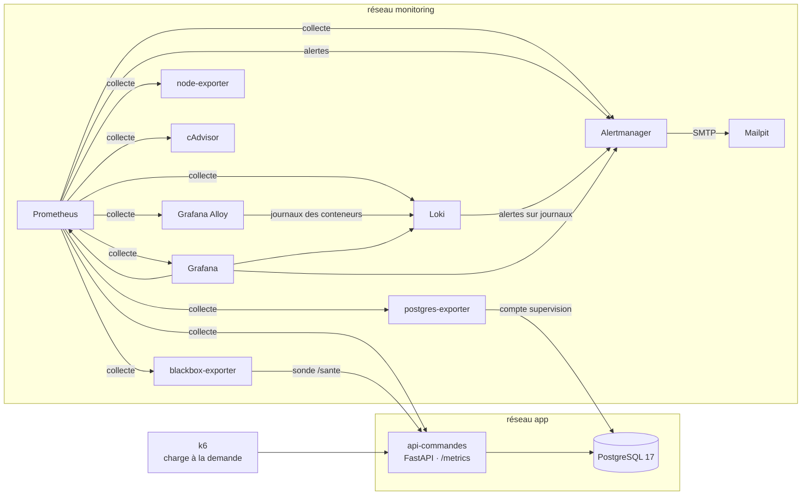

# Architecture

## Vue d'ensemble

Deux réseaux Docker séparent les rôles :

| Réseau | Services | Pourquoi |
| --- | --- | --- |
| `app` | API, PostgreSQL, postgres-exporter, k6 | La base n'est joignable que par ceux qui en ont besoin |
| `monitoring` | Toute la supervision, plus l'API (pour être collectée) et postgres-exporter | Les outils de supervision ne voient pas la base |

Seuls deux services sont sur les deux réseaux, chacun pour une raison précise : l'**API** (servir les utilisateurs et être collectée) et **postgres-exporter** (lire la base et être collecté).

## Services

| Service | Image | Rôle | Limite RAM |
| --- | --- | --- | --- |
| api-commandes | construite depuis `app/` | API de démonstration instrumentée | 128 Mo |
| postgres | `postgres:17` | Base de l'API | 192 Mo |
| prometheus | `prom/prometheus:v3.13.5` (LTS) | Collecte, règles SLO, alertes | 384 Mo |
| alertmanager | `prom/alertmanager:v0.35.0` | Regroupement, routage, inhibition | 64 Mo |
| loki | `grafana/loki:3.7.10` | Stockage des journaux, alerte sur journaux | 256 Mo |
| alloy | `grafana/alloy:v1.22.0` | Collecte des journaux Docker | 192 Mo |
| grafana | `grafana/grafana:13.3.1` | Tableaux de bord | 384 Mo |
| node-exporter | `prom/node-exporter:v1.13.1` | Métriques de l'hôte | 32 Mo |
| cadvisor | `ghcr.io/google/cadvisor:v0.60.4` | Métriques par conteneur | 128 Mo |
| postgres-exporter | `prometheuscommunity/postgres-exporter:v0.19.1` | Métriques de la base | 32 Mo |
| blackbox-exporter | `prom/blackbox-exporter:v0.29.1` | Sonde HTTP de l'API | 32 Mo |
| mailpit | `axllent/mailpit:v1.34.0` | Boîte mail locale des alertes | 64 Mo |
| k6 | `grafana/k6:2.4.0` (profil `charge`) | Générateur de charge | 128 Mo |

Toutes les versions sont épinglées dans `.env` : aucune image n'utilise `latest`.

## Ports

| Port | Service | Publié |
| --- | --- | --- |
| 3000 | Grafana | Toujours, sur `127.0.0.1` |
| 8000 | API | Toujours, sur `127.0.0.1` |
| 8025 | Mailpit (interface) | Toujours, sur `127.0.0.1` |
| 9090, 9093, 3100, 12345 | Prometheus, Alertmanager, Loki, Alloy | **Mode débogage seulement** (`compose.debug.yaml`) |

Le mode débogage (`make up-debug`) ajoute ces ports par un second fichier Compose, sans modifier `compose.yaml`. En mode normal (`make up`), les services internes ne sont pas joignables depuis l'hôte (ES-02).

## Décisions d'architecture

| Décision | Raison |
| --- | --- |
| Docker Compose plutôt que Kubernetes | Un fichier, une commande, moins de 2 Go de RAM |
| **Docker Engine natif dans WSL2** plutôt que Docker Desktop | Docker Desktop isole son moteur dans un espace que les montages n'atteignent pas : cAdvisor ne voyait ni containerd ni les cgroups des conteneurs, et node-exporter ne pouvait pas lire `/proc`. Avec Docker Engine installé dans Ubuntu (WSL2), la machine se comporte comme un serveur Linux, et la RAM de la VM Docker Desktop est économisée |
| Prometheus en version LTS | Correctifs de sécurité sur toute la durée du projet |
| Grafana Alloy pour les journaux | Promtail est en fin de vie depuis mars 2026 ; Alloy est son successeur officiel |
| Mailpit pour les notifications | Aucun compte externe ni mot de passe réel dans le labo |
| Application avec points d'injection de pannes | Chaque alerte peut être déclenchée à la demande et prouvée |
