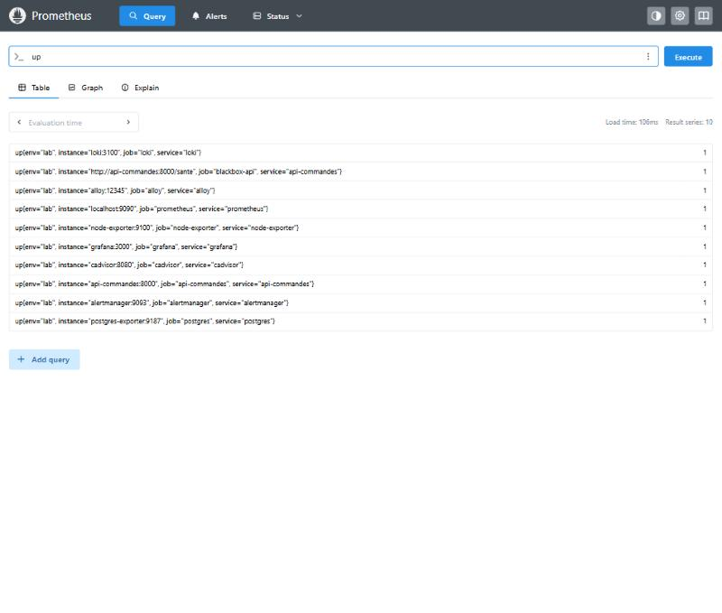

# Étape 3 — Métriques : Prometheus et exporteurs

**Objectif :** collecter les métriques de l'API, des conteneurs, de l'hôte et de la base.

**Exigences :** EF-06 à EF-09.

## Cibles collectées (toutes les 15 s)

| Job | Cible | Ce qu'on y lit |
| --- | --- | --- |
| `api-commandes` | `api-commandes:8000` | RED de l'API, métrique métier |
| `blackbox-api` | blackbox → `http://api-commandes:8000/sante` | Disponibilité vue de l'extérieur (`probe_success`) |
| `node-exporter` | `node-exporter:9100` | CPU, mémoire, disque de l'hôte (la VM WSL2) |
| `cadvisor` | `cadvisor:8080` | CPU, mémoire, redémarrages par conteneur |
| `postgres` | `postgres-exporter:9187` | `pg_up`, connexions, taille de la base |
| `prometheus`, `alertmanager`, `loki`, `alloy`, `grafana` | — | Santé de la supervision elle-même |

Chaque cible porte `service` et `env="lab"` (EF-07). Rétention : 7 jours ou 2 Go (`--storage.tsdb.retention.time=7d`, `--storage.tsdb.retention.size=2GB`).

## Points techniques

- **blackbox-exporter** utilise des `relabel_configs` : la cible déclarée (`http://api-commandes:8000/sante`) devient le paramètre `target`, et l'adresse réellement interrogée est celle de l'exporteur.
- **node-exporter** tourne avec `pid: host` et lit `/proc` de l'hôte par ce biais ; `/sys` et `/` sont montés en lecture seule.
- **cAdvisor** a besoin de voir containerd et les cgroups des conteneurs. C'est la raison du passage de Docker Desktop à **Docker Engine natif dans WSL2** (voir [architecture](01-architecture.md#décisions-darchitecture)). Il est lancé avec `--docker_only` et une liste de métriques réduite pour rester sous 128 Mo.
- **postgres-exporter** se connecte avec un compte dédié `supervision`, membre du rôle `pg_monitor` (lecture des statistiques, aucun accès aux données), créé par `postgres/init/01-supervision.sh`.

## Vérifier

```bash
make up-debug                       # publie Prometheus sur 127.0.0.1:9090
# http://localhost:9090/targets : 10 cibles UP
```

Requêtes utiles :

```promql
up                                              # 1 par cible
probe_success{job="blackbox-api"}               # 1 si /sante répond
sum by (name) (container_memory_working_set_bytes{name!=""})
pg_up
```


