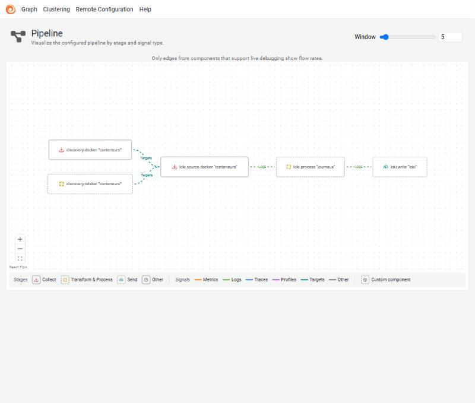

# Étape 4 — Journaux : Loki et Grafana Alloy

**Objectif :** centraliser les journaux de tous les conteneurs, sans étiquette à forte cardinalité.

**Exigences :** EF-10 à EF-12.

## Chaîne de collecte

```text
conteneurs ──(socket Docker, lecture seule)──> Alloy ──> Loki ──> Grafana
```

`alloy/config.alloy` suit quatre blocs :

1. `discovery.docker` découvre les conteneurs du projet Compose `obslab` ;
2. `discovery.relabel` en tire les étiquettes `service` (nom du service Compose) et `container` ;
3. `loki.source.docker` lit leurs journaux ;
4. `loki.process` ajoute `env="lab"` et, pour l'API seulement, extrait `niveau` du JSON pour en faire une étiquette.

Tout le reste (identifiant de requête, route, durée) reste dans le contenu du journal : ces valeurs changent à chaque requête et feraient exploser le nombre de flux (EF-11).

Loki tourne en mode monolithique, rétention 7 jours appliquée par le compacteur (EF-12). Son **ruler** évalue la règle `ErreursApplicatives` (`loki/rules/alertes-journaux.yml`) et l'envoie à Alertmanager.

## Vérifier

```bash
make up-debug     # publie Loki (3100) et l'interface d'Alloy (12345)
```

- `http://localhost:12345` : graphe des composants Alloy, tous sains.
- Dans Grafana Explore, source Loki :

```logql
{service="api-commandes", niveau="ERROR"}
sum by (service) (count_over_time({env="lab"}[5m]))
```



## À savoir

Promtail est en fin de vie depuis le 2 mars 2026 ; Alloy est son remplaçant officiel. Le socket Docker monté dans Alloy est une exception de sécurité documentée dans [securite.md](securite.md).
