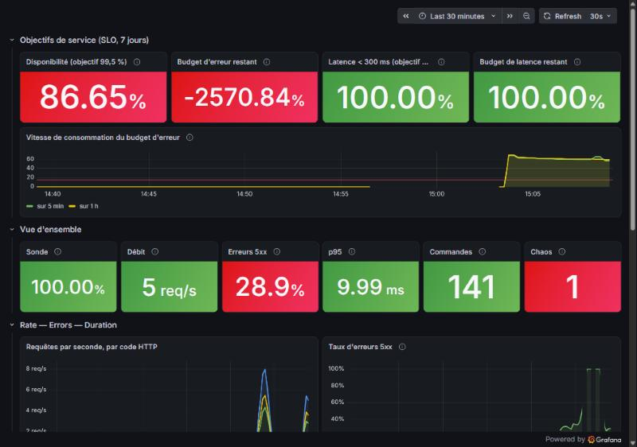
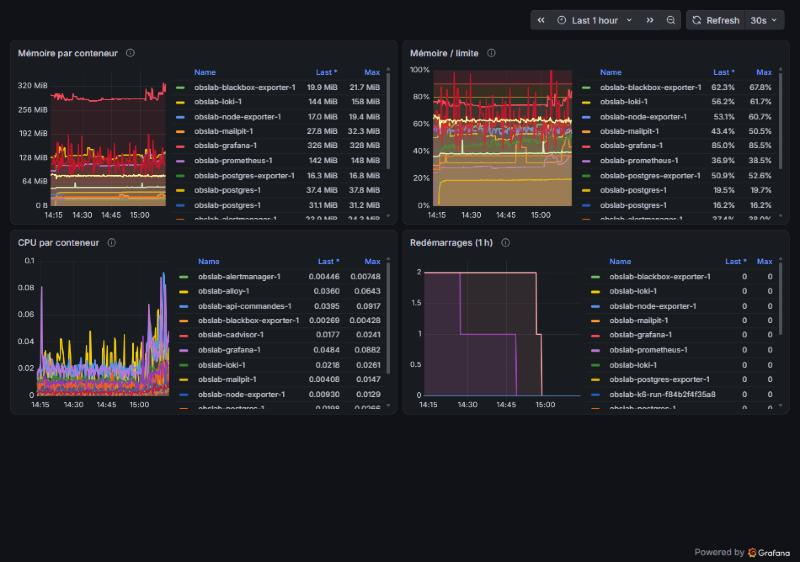

# Étape 5 — Tableaux de bord Grafana

**Objectif :** visualiser l'état du service et des conteneurs, avec des tableaux de bord décrits en code.

**Exigences :** EF-13 à EF-15.

## Provisionnement

Rien n'est configuré à la main dans l'interface : tout est lu au démarrage depuis `grafana/`.

| Fichier | Rôle |
| --- | --- |
| `provisioning/datasources/datasources.yaml` | Sources Prometheus, Loki et Alertmanager, avec des `uid` fixes réutilisés par les tableaux de bord |
| `provisioning/dashboards/dashboards.yaml` | Charge les JSON de `grafana/dashboards/` dans le dossier **Labo**, modification dans l'interface interdite (`allowUiUpdates: false`) |
| `dashboards/api-commandes-red.json` | Tableau de bord du service |
| `dashboards/conteneurs-use.json` | Tableau de bord des conteneurs |

Pour modifier un tableau de bord : l'exporter en JSON depuis Grafana, remplacer le fichier dans le dépôt, puis `docker compose restart grafana`.

## Service — api-commandes (RED)

| Rangée | Panneaux |
| --- | --- |
| Objectifs de service (SLO, 7 jours) | Disponibilité, budget d'erreur restant, latence < 300 ms, budget de latence restant, vitesse de consommation du budget (5 min et 1 h) |
| Vue d'ensemble | Sonde, débit, erreurs 5xx, p95, commandes créées, pannes actives |
| Rate — Errors — Duration | Requêtes/s par code, taux d'erreurs 5xx, latence p50/p95/p99, pannes injectées |
| Journaux | Journaux `ERROR` et `WARNING` de l'API (Loki) |

La rangée « Journaux » est sur la même page que les graphiques et partage leur période : un pic d'erreurs se lit directement à côté des lignes de journal qui l'expliquent (EF-15).

Les indicateurs SLO sont en rouge sur toutes les captures : ils portent sur 7 jours et intègrent les pannes provoquées pendant les tests.

## Conteneurs (USE)

Mémoire par conteneur, mémoire rapportée à la limite (saturation), CPU par conteneur, redémarrages sur 1 h. Source : cAdvisor.

## Vérifier

1. `http://localhost:3000`, compte défini dans `.env`.
2. Dossier **Labo** : les deux tableaux de bord sont présents.
3. Test du provisionnement : `make clean && make up` (supprime les volumes) ; les tableaux de bord reviennent sans aucun clic.

## Écart avec le cahier des charges

Le cahier des charges prévoyait quatre tableaux de bord. Les vues « Hôte » et « Journaux » ne sont pas des tableaux de bord séparés : les journaux d'erreur sont intégrés au tableau de bord du service, et l'exploration libre se fait dans Grafana Explore. Les ajouter est une extension simple (voir [résultats](10-resultats.md#écarts-et-suites)).
