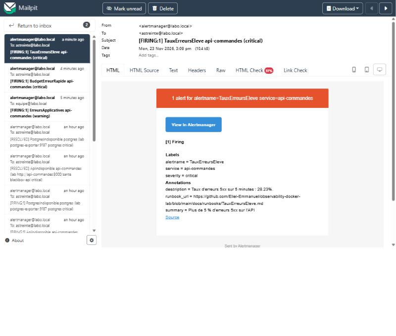

# Étape 7 — Alertes : Prometheus, Loki, Alertmanager, Mailpit

**Objectif :** être prévenu des pannes qui touchent les utilisateurs, avec le bon niveau d'urgence et une procédure pour chaque alerte.

**Exigences :** EF-17 à EF-22, EF-25.

## Chaîne d'alerte

```mermaid
flowchart LR
    pr[Prometheus<br/>règles d'alerte] --> am[Alertmanager]
    lr[Loki ruler<br/>alerte sur journaux] --> am
    am -- critical --> a[astreinte@labo.local]
    am -- warning --> e[equipe@labo.local]
    am -- Watchdog --> w[watchdog@labo.local]
    a & e & w --> mp[Mailpit<br/>127.0.0.1:8025]
```

## Règles

| Alerte | Source | Condition | Durée | Gravité |
| --- | --- | --- | --- | --- |
| ApiIndisponible | Prometheus | `probe_success == 0` (sonde blackbox sur `/sante`) | 1 min | critical |
| TauxErreursEleve | Prometheus | Plus de 5 % de 5xx sur 5 min | 5 min | critical |
| LatenceElevee | Prometheus | p95 > 500 ms sur 5 min | 5 min | warning |
| BudgetErreurRapide | Prometheus | Part d'erreurs > 7 % (burn rate 14) sur 1 h **et** sur 5 min | 2 min | critical |
| CibleInjoignable | Prometheus | `up == 0` | 2 min | warning |
| PostgresIndisponible | Prometheus | `pg_up == 0` | 1 min | critical |
| ConteneurRedemarre | Prometheus | Plus de 2 démarrages d'un conteneur en 15 min | immédiate | warning |
| MemoireConteneurProcheLimite | Prometheus | Mémoire > 85 % de la limite du conteneur | 5 min | warning |
| DisqueHotePresquePlein | Prometheus | Moins de 15 % d'espace libre | 10 min | warning |
| ErreursApplicatives | Loki | Plus de 20 journaux `ERROR` en 5 min | 1 min | warning |
| Watchdog | Prometheus | Toujours vraie | — | none |

Chaque règle porte `summary`, `description` et `runbook_url` vers sa procédure dans [`docs/runbooks/`](runbooks/README.md) (EF-22).

## Alertmanager (`alertmanager/alertmanager.yml`)

| Réglage | Valeur | Effet |
| --- | --- | --- |
| `group_by` | `alertname`, `service` | Un mail par alerte et par service, pas un mail par cible |
| `group_wait` | 30 s | Les alertes simultanées partent dans le même mail |
| `group_interval` | 5 min | Délai avant d'envoyer les nouveautés d'un groupe déjà notifié |
| `repeat_interval` | 4 h (12 h pour Watchdog) | Rappel tant que l'alerte dure |
| `send_resolved` | `true` | Un mail `[RESOLVED]` à la fin de la panne |

**Inhibition (EF-21) :** quand `ApiIndisponible` est active, `TauxErreursEleve`, `LatenceElevee` et `BudgetErreurRapide` ne sont pas envoyées pour le même service : l'API arrêtée explique déjà tout.

**Watchdog :** toujours active, routée vers une boîte dédiée. Si elle disparaît, c'est la chaîne d'alerte elle-même qui est en panne.

Prometheus et Alertmanager sont lancés avec `--web.external-url` (`http://localhost:9090`, `http://localhost:9093`) : les liens « Source » et « View in Alertmanager » des mails pointent vers une adresse joignable depuis le navigateur, et non vers le nom interne du conteneur.

## Tests unitaires des alertes (EF-25)

`prometheus/tests/alertes-test.yml` simule, pour chaque alerte, une série qui doit la déclencher et une qui ne doit pas. Ils tournent en CI :

```bash
docker run --rm -v "$PWD/prometheus:/p" --entrypoint promtool prom/prometheus:v3.13.5 test rules /p/tests/alertes-test.yml
docker run --rm -v "$PWD/alertmanager:/a" --entrypoint amtool prom/alertmanager:v0.35.0 check-config /a/alertmanager.yml
```

## Vérifier

```bash
make up-debug
# http://localhost:9090/alerts   : règles chargées, Watchdog en FIRING
# http://localhost:9093          : Watchdog reçue par Alertmanager
# http://localhost:8025          : mail Watchdog dans Mailpit
```



## Écart avec le cahier des charges

L'envoi Telegram (EF-20, optionnel) n'est pas configuré : toutes les notifications passent par Mailpit.
