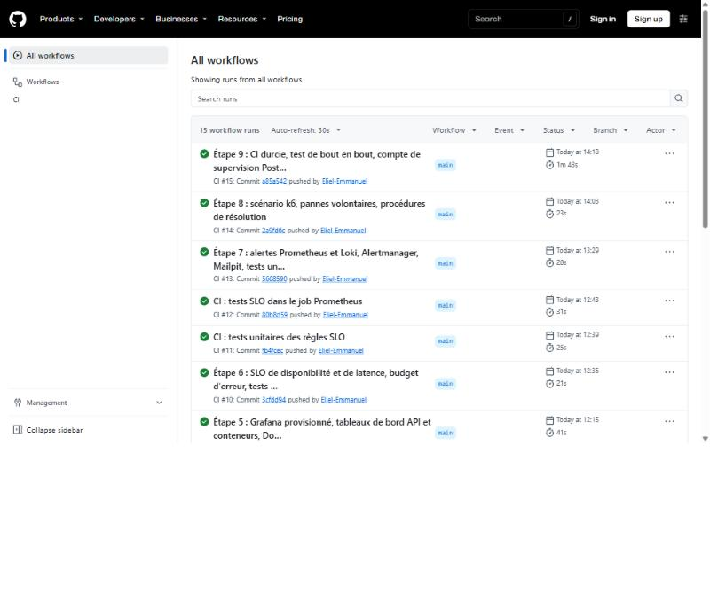

# Étape 9 — Intégration continue et durcissement

**Objectif :** valider chaque modification automatiquement, de la syntaxe jusqu'à une pile complète démarrée sur le runner, et réduire la surface d'attaque des conteneurs.

**Exigences :** ES-01 à ES-07, ENF-04, ENF-05.

## Pipeline GitHub Actions (`.github/workflows/ci.yml`)

À chaque push et pull request, 10 jobs :

| Job | Vérifie |
| --- | --- |
| Application | ruff (lint et format) et 12 tests pytest |
| Dockerfile | hadolint, puis construction de l'image |
| Trivy | Image de l'API : échec si une vulnérabilité **critique corrigeable** est présente (ES-06) ; rapport des vulnérabilités hautes |
| Secrets | gitleaks sur tout l'historique Git (ES-01) |
| Style | yamllint sur tous les YAML, shellcheck sur les scripts |
| Compose | `docker compose config` sur `compose.yaml` et l'overlay de débogage |
| Prometheus | `promtool check config`, `check rules`, `test rules` (SLO et alertes) |
| Alloy | Validation de `config.alloy` |
| Alertmanager | `amtool check-config` |
| Test de bout en bout | Démarre la pile complète, attend que tous les services soient `healthy`, puis lance `tests/e2e.sh` |

Le test de bout en bout ne démarre que si les jobs de validation sont passés. Il vérifie en 9 points que la chaîne fonctionne réellement :

1. l'API répond sur `/sante` ;
2. elle crée une commande ;
3. elle relit cette commande ;
4. les 10 cibles Prometheus sont `up` ;
5. au moins 20 règles sont chargées ;
6. la sonde blackbox réussit ;
7. les journaux de l'API sont dans Loki ;
8. Prometheus voit Alertmanager ;
9. le mail Watchdog est arrivé dans Mailpit.

Durée observée : environ 1 min 45 pour tout le pipeline, dont 1 min 25 pour le test de bout en bout.



## Chaîne d'approvisionnement

- Toutes les actions GitHub sont épinglées par **empreinte de commit (SHA)**, pas par étiquette : une étiquette peut être déplacée vers du code malveillant, une empreinte non.
- Trivy et gitleaks sont lancés depuis leurs **images officielles épinglées** (`aquasec/trivy:0.76.2`, `zricethezav/gitleaks:v8.30.1`) plutôt que par des actions tierces. En mars 2026, l'action GitHub de Trivy a été compromise : ses étiquettes pointaient vers du code qui volait les secrets des pipelines.
- Le workflow n'a que la permission `contents: read`.

## Durcissement

Détail complet, avec les trois exceptions (cAdvisor privilégié, `pid: host` pour node-exporter, socket Docker pour Alloy et cAdvisor) : [securite.md](securite.md).

## Vérifier en local

```bash
make up-debug
bash tests/e2e.sh        # 9 vérifications « OK »
curl -s localhost:9090   # sans le mode débogage : connexion refusée (ES-02)
```
