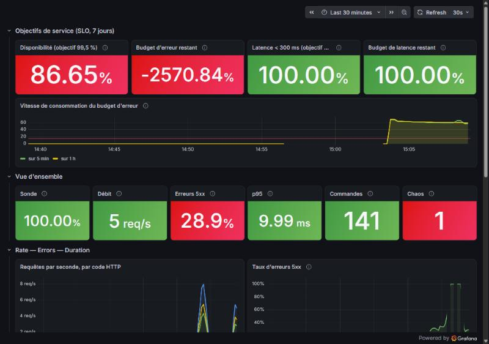
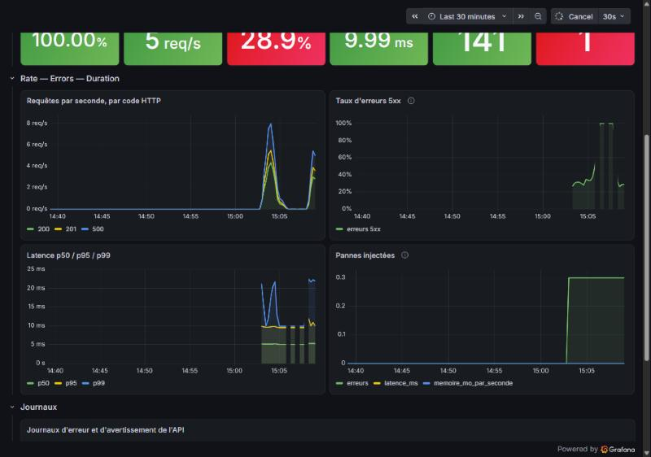
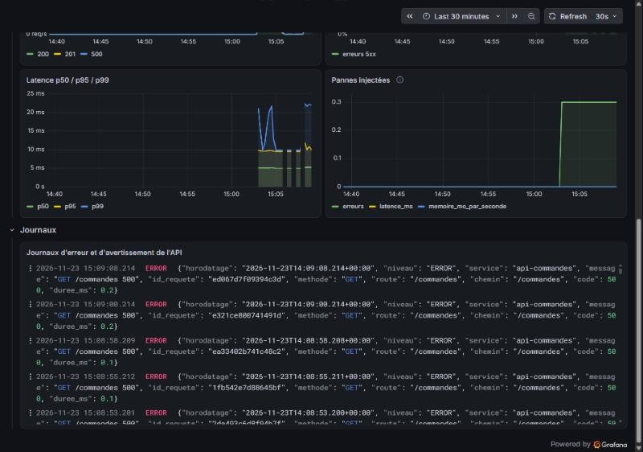
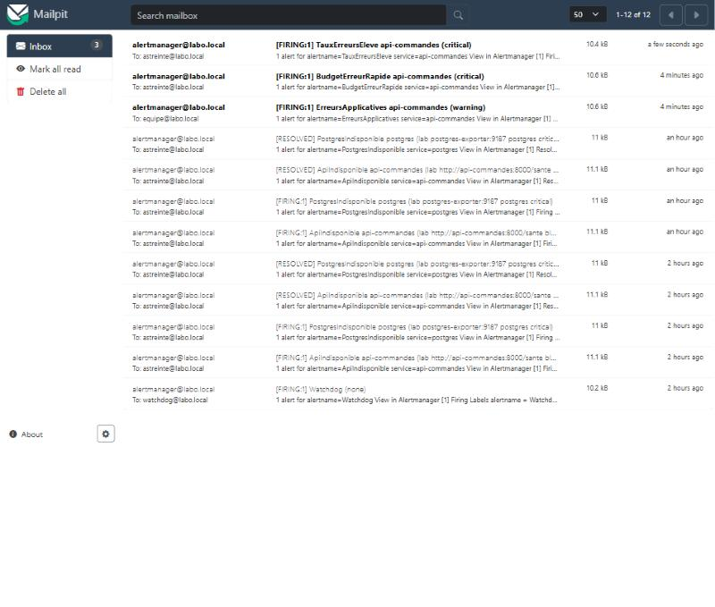
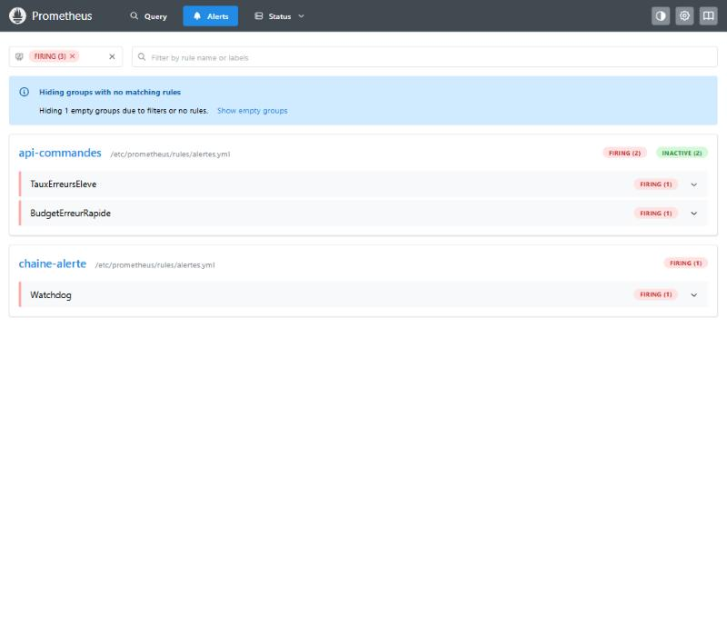
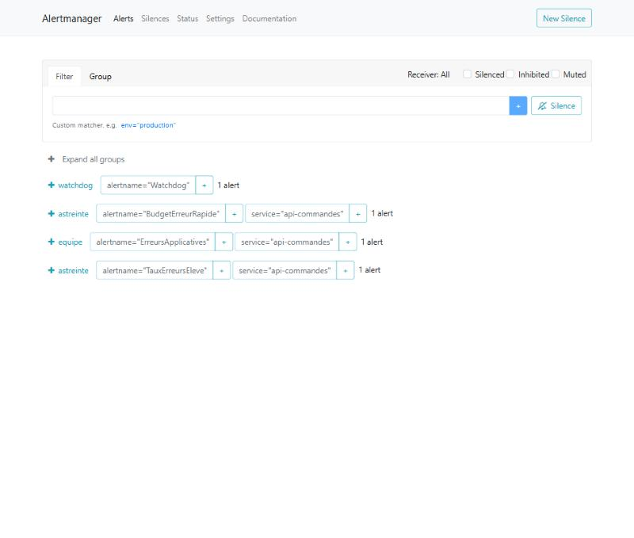
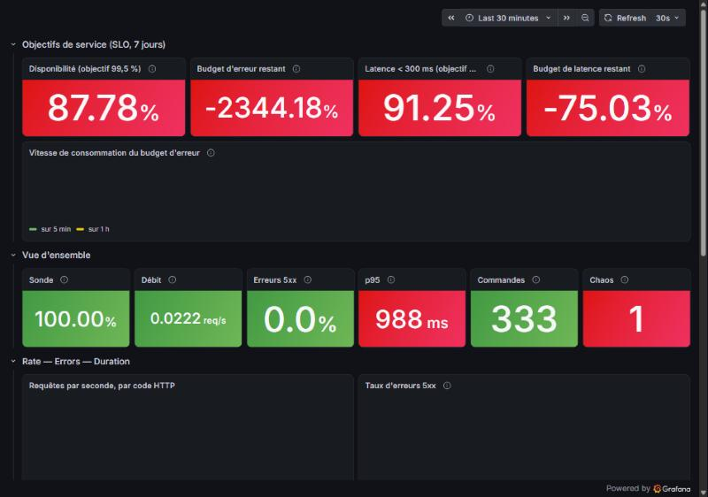
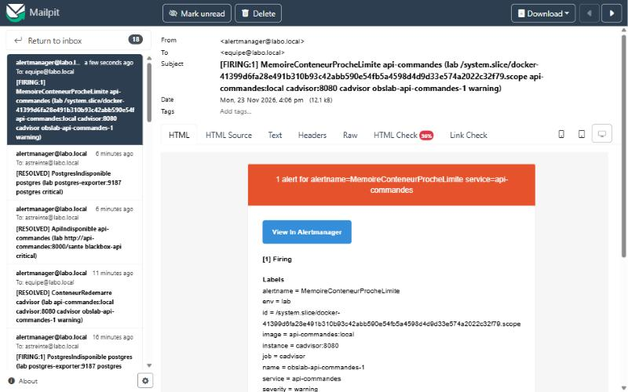
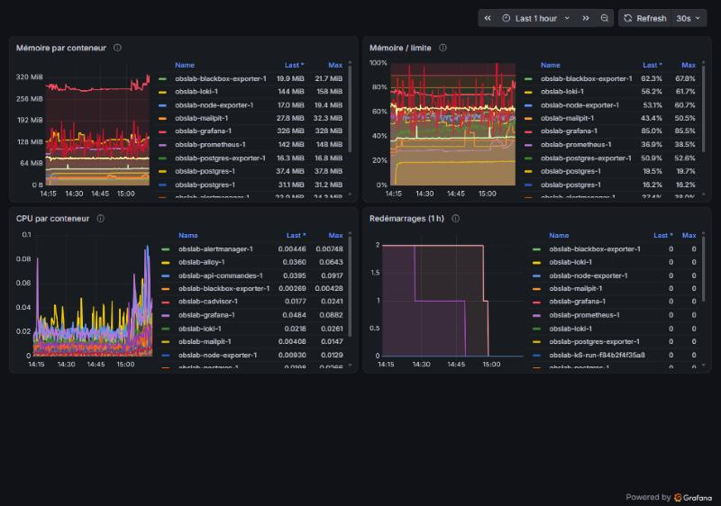

# Étape 10 — Résultats

**Objectif :** prouver que chaque panne est détectée, notifiée au bon destinataire et résolue, en mesurant les délais réels.

**Date des mesures :** 23 novembre 2026, sur le poste du labo (HP EliteBook, 8 Go, Ubuntu dans WSL2, Docker Engine).

## Méthode

1. La pile tourne en mode débogage (`make up-debug`), les 10 cibles Prometheus sont `up`.
2. Pour les pannes de l'API (erreurs, latence), un trafic de fond est envoyé à l'API : 80 % de lectures, 20 % de créations.
3. Chaque panne est déclenchée par la même requête que la cible `make` correspondante. On note l'heure de début.
4. Le **délai** est mesuré entre le début de la panne et l'arrivée du mail dans Mailpit (horodatage du mail).
5. On met fin à la panne (`make retablir` ou `POST /chaos/reset`) et on attend le mail `[RESOLVED]`.

Les heures sont en UTC. Pour les pannes lancées par `make` (API, base), l'heure de début est déduite du premier échec de collecte, à 15 s près.

## Synthèse

| Panne | Commande | Alerte | Destinataire | Mail reçu après | Résolution reçue après la fin |
| --- | --- | --- | --- | --- | --- |
| 30 % d'erreurs 500 | `make panne-erreurs` | ErreursApplicatives (Loki) | équipe | 2 min 33 | 5 min 13 |
| | | BudgetErreurRapide | astreinte | 3 min 21 | 6 min 01 |
| | | TauxErreursEleve | astreinte | 6 min 21 | 4 min 01 |
| 800 ms de latence | `make panne-latence` | LatenceElevee | équipe | 5 min 56 | 4 min 01 |
| API arrêtée | `make panne-api` | ApiIndisponible | astreinte | 1 min 44 | 2 min 54 |
| | | CibleInjoignable | équipe | 2 min 39 | 3 min 49 |
| Base arrêtée | `make panne-db` | ApiIndisponible | astreinte | 1 min 39 | 3 min 39 |
| | | PostgresIndisponible | astreinte | 1 min 49 | 3 min 49 |
| Mémoire vers 87 % de la limite | `make panne-memoire` | MemoireConteneurProcheLimite | équipe | 6 min 48 | |
| 3 arrêts par manque de mémoire | `make panne-redemarrages` | ConteneurRedemarre | équipe | 2 min 30 | après 15 min (fenêtre de la règle) |

**Critère d'acceptation** (cahier des charges, section 5.3) : alerte active et mail reçu en moins de 10 minutes pour chaque panne. **Atteint pour les 6 pannes.**

## Lecture des délais

Le délai d'une alerte est la somme de quatre attentes :

| Attente | Valeur | Rôle |
| --- | --- | --- |
| Collecte | 15 s | Prometheus lit les métriques toutes les 15 s |
| Fenêtre de calcul | 0 à 5 min | Un `rate(...[5m])` met du temps à franchir le seuil |
| Durée `for` | 1 à 5 min | La condition doit tenir avant que l'alerte parte |
| Regroupement | 30 s | `group_wait` d'Alertmanager |

C'est pourquoi les alertes les plus graves ont les durées les plus courtes : `ApiIndisponible` et `PostgresIndisponible` (`for: 1m`) arrivent en moins de 2 minutes, alors que `TauxErreursEleve` et `LatenceElevee` (`for: 5m`) arrivent en 6 minutes.

**L'alerte de consommation du budget arrive avant l'alerte sur le taux d'erreurs** (3 min 21 contre 6 min 21) : son seuil est plus haut (7 % au lieu de 5 %) mais sa durée `for` est plus courte (2 min au lieu de 5). Sur une panne franche, elle prévient l'astreinte en premier ; `TauxErreursEleve` reste utile pour les dégradations lentes, sous 7 %.

**L'alerte sur les journaux est la plus rapide** (2 min 33) : elle compte les lignes `ERROR` dès qu'elles arrivent dans Loki, sans attendre qu'un taux se stabilise.

## Observations par panne

### Erreurs 500 (30 %)

Trois alertes, deux destinataires : `BudgetErreurRapide` et `TauxErreursEleve` (critical) à l'astreinte, `ErreursApplicatives` (warning, issue de Loki) à l'équipe. Les trois mails de résolution sont arrivés entre 4 et 6 minutes après la fin de la panne.

### Latence (800 ms)

`LatenceElevee` (p95 > 500 ms pendant 5 min) envoyée à l'équipe. Le tableau de bord montre le p95 proche de 1 s et l'indicateur « latence < 300 ms » qui chute.

### API arrêtée

`ApiIndisponible` (sonde blackbox) à l'astreinte, puis `CibleInjoignable` (`up == 0`) à l'équipe.

Aucun mail `TauxErreursEleve` n'est arrivé. Mais l'inhibition n'a pas eu à agir : l'API arrêtée refuse les connexions au lieu de répondre 500, donc aucune alerte sur les erreurs ne s'est déclenchée. La règle d'inhibition est vérifiée par `amtool check-config` ; pour la voir agir, il faudrait que les erreurs et l'indisponibilité surviennent ensemble (par exemple une API qui répond 503 à la sonde).

### Base de données arrêtée

`PostgresIndisponible` et `ApiIndisponible` à l'astreinte, à 10 secondes d'écart : `/sante` vérifie la base, donc la sonde échoue aussi. Pas de `CibleInjoignable` : postgres-exporter reste joignable et signale `pg_up = 0`.

Le runbook `ApiIndisponible` invite à regarder d'abord `PostgresIndisponible`. Une règle d'inhibition `PostgresIndisponible → ApiIndisponible` éviterait le second mail (voir [écarts et suites](#écarts-et-suites)).

### Mémoire proche de la limite

Fuite plafonnée à 68 Mo (2 Mo/s) : la mémoire de l'API se stabilise vers 88 % de sa limite. `MemoireConteneurProcheLimite` passe en attente au bout d'environ 1 min 20, se déclenche 5 min plus tard et part à l'équipe, avec `service="api-commandes"`. Ce résultat a été obtenu après deux corrections (voir plus bas).

À surveiller : Grafana monte jusqu'à 85 % de sa limite de 384 Mo pendant les rechargements de tableaux de bord. Si `MemoireConteneurProcheLimite` se déclenche pour Grafana, c'est un vrai signal : relever sa limite à 512 Mo.

### Redémarrages en boucle

Trois fuites rapides (20 Mo/s, sans plafond) : l'API est tuée par manque de mémoire trois fois en moins de 2 minutes, puis relancée par Docker (`restart: unless-stopped`). `ConteneurRedemarre` est envoyée à l'équipe. Aucune `ApiIndisponible` : chaque redémarrage dure environ 15 s, moins que la durée `for: 1m` de la sonde.

## Problèmes trouvés par les tests, et corrections

Les tests ont révélé trois défauts que les tests unitaires des règles ne pouvaient pas voir, parce qu'ils viennent du comportement réel du noyau et de cAdvisor.

### Panne mémoire : deux corrections

**1. Le swap masquait la saturation.** Avec le swap de WSL2 autorisé, le noyau a envoyé une partie de la mémoire de l'API dans le swap (19 Mo) dès qu'elle approchait sa limite. La mémoire mesurée (`working_set`) plafonnait à 88 %, sous le seuil de 90 % : l'alerte ne pouvait pas se déclencher, alors que le service ralentissait.

*Correction :* `memswap_limit: 128M` pour l'API (mémoire + swap = limite, donc aucun swap). Le runbook signale aussi de regarder `container_memory_swap`.

**2. Le seuil de 90 % était inatteignable.** Sans swap, l'API a été tuée par manque de mémoire dès que son `working_set` dépassait environ 88 % de la limite : la limite compte aussi de la mémoire que le `working_set` n'inclut pas (mémoire du noyau, une partie du cache). Mesures :

| Fuite plafonnée à | Résultat |
| --- | --- |
| 68 Mo | Stable à 87,5 % |
| 70 Mo | Tuée (OOM) |
| 72 Mo | Tuée (OOM) |
| 75 Mo | Tuée (OOM) |

*Correction :* seuil abaissé à **85 %** pendant 5 min, et `make panne-memoire` plafonne la fuite à 68 Mo. L'alerte laisse ainsi une vraie marge pour agir avant l'arrêt.

### Mauvais service dans les alertes de conteneur

Le premier mail `ConteneurRedemarre` portait `service="cadvisor"` : les métriques de cAdvisor héritent de l'étiquette de la cible collectée, pas du conteneur observé. Le mail était donc regroupé et routé comme une alerte sur cAdvisor.

*Correction :* `label_replace` dans `ConteneurRedemarre` et `MemoireConteneurProcheLimite`, qui tire `service` du nom du conteneur (`obslab-api-commandes-1` → `api-commandes`). Les tests unitaires ont été mis à jour, et le mail de la panne mémoire porte bien `service="api-commandes"`.

## Ressources

Pile complète en fonctionnement : 12 conteneurs (13 avec k6) sous leurs limites, environ 1,1 Go au total. Les plus gros consommateurs sont Grafana (environ 300 Mo sur 384) et Prometheus (environ 160 Mo sur 384). Mesure : `sum(container_memory_working_set_bytes{name=~"obslab.*"})`, environ 1 060 Mo pendant la panne mémoire.

## Écarts et suites

| Point | État | Suite proposée |
| --- | --- | --- |
| Tableaux de bord « Hôte » et « Journaux » (EF-14) | Non réalisés ; journaux intégrés au tableau de bord du service | Ajouter les deux JSON |
| Lien direct d'un panneau vers Explore (EF-15) | Corrélation par la rangée « Journaux » sur la même période | Ajouter un lien de données sur le panneau des erreurs |
| Telegram (EF-20, optionnel) | Non configuré | Récepteur `telegram_configs` avec jeton dans `.env` |
| Inhibition sur panne de base | `ApiIndisponible` et `PostgresIndisponible` arrivent toutes deux | Règle `PostgresIndisponible → ApiIndisponible` |
| Inhibition observée en conditions réelles | Règle validée par `amtool`, non sollicitée par les pannes du labo | Panne combinée : erreurs 500 + sonde en échec |
